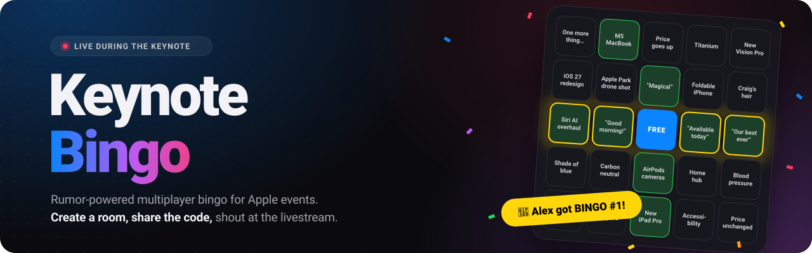

Multiplayer bingo for watching Apple keynotes with friends. Topics are generated from the latest Apple news and rumors (MacRumors, 9to5Mac, AppleInsider) by a local Ollama model, mixed with classic keynote memes.

## Requirements

- Node.js 24+ (no npm dependencies)
- [Ollama](https://ollama.com) with a model pulled, by default `gemma4`
- [cloudflared](https://developers.cloudflare.com/cloudflare-one/connections/connect-networks/) to share it with friends: `brew install cloudflared`

## Run

```sh
npm start                                 # http://localhost:3000
cloudflared tunnel --url localhost:3000   # public https://….trycloudflare.com link
```

Open the tunnel URL, create a room and share the invite link (or the 6-character code).

| Env var        | Default                  |
| -------------- | ------------------------ |
| `PORT`         | `3000`                   |
| `OLLAMA_MODEL` | `gemma4`                 |
| `OLLAMA_URL`   | `http://localhost:11434` |

## How it plays

1. The host creates a room. The server fetches the RSS feeds and asks the LLM for ~30 topics, then adds ~20 keynote memes. If the LLM is unavailable, raw headlines are used instead.
2. The host edits the topic pool (one per line, at least 24) and starts the game.
3. Every player gets a random 5x5 card with a free center cell. Players can join late.
4. Marks are global: anyone taps a topic (on their card or in the "All topics" list) when it happens, and anyone can unmark mistakes. Every action shows up in the activity feed.
5. A row, column or diagonal is a bingo. Bingos are ranked in order on the leaderboard and the game continues.

Room state is saved to `rooms.json`, so restarting the server mid-keynote loses nothing. Players are identified by an ID in `localStorage`, so reloading brings back the same card.

## Files

- `server.js`: HTTP server (clients poll `/api/state`), game logic, topic generation
- `index.html`: the whole frontend (vanilla JS, no build step)
- `bingo.test.js`: tests for card dealing and line detection, run with `npm test`

## License

[MIT](LICENSE)
